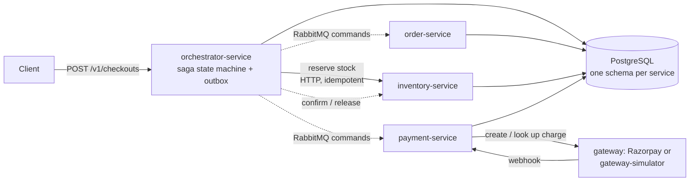

# distri

[](https://github.com/chrisfonseca8/distri/actions/workflows/ci.yml)
[](https://github.com/chrisfonseca8/distri/actions/workflows/stack.yml)
[](https://github.com/chrisfonseca8/distri/actions/workflows/publish-images.yml)

**A fault-tolerant checkout and payment backend in Go, built to measure what actually limits a distributed system.**

Four services coordinate an order through an orchestrated **saga** with compensations, a transactional **outbox**, RabbitMQ commands, and PostgreSQL as the single source of truth. There is no UI: everything is driven by APIs, scripts and a Go load generator. The project was built to learn, with measurements, how concurrency, architecture and infrastructure change the correctness and performance of a payment flow.

## Highlights

Measured on AWS in November 2026 against a **simulated payment gateway** (about 5 s of every checkout is its configured pay delay).

| Area | Result |
|---|---|
| Sustained load | 100 checkouts/s for 3 min: **18,000 of 18,000 completed**, 0 errors, saga p95 11.2 s |
| Highest rate passed | 130 checkouts/s: **23,401 of 23,401 completed**; the API accepts a checkout in 67 ms (p95) |
| Autoscaling | At 60/s, saga p95 fell from **80 s to 10.9 s** once webhook workers and DB pools scaled on load (single runs; the client polling interval also changed) |
| Correctness | **10 of 10** data invariants hold under load; 500 concurrent buyers for 10 units sold **exactly 10** |
| Fault tolerance | **7 of 7** failure scenarios passed (`kill -9` of each service, broker restart, 20 s DB drop, 200 ms network delay): 0 duplicate payments, 0 lost checkouts |
| Tests | **470 passing, 0 failing** with the race detector; a 20-phase correctness suite across success, decline and timeout gateway modes |

Single runs unless stated. Full numbers and caveats: [`tests/REPORT.md`](tests/REPORT.md) and [`inprovemts/`](inprovemts).

## Architecture



| Module | Responsibility |
|---|---|
| [`orchestrator-service`](orchestrator-service) | Checkout idempotency, saga state machine, outbox relay, status streaming (SSE), pool autoscaler |
| [`order-service`](order-service) | Order data and state transitions |
| [`inventory-service`](inventory-service) | Products, stock, reservations (no oversell, deadlock-resistant multi-item locking) |
| [`payment-service`](payment-service) | Payment attempts, reconciliation, webhooks (signature-verified), refunds, webhook-worker autoscaler |
| [`gateway-simulator`](gateway-simulator) | Controllable fake gateway: success, decline, timeout, delays |
| [`tools`](tools) | Load generator, correctness suite, fault injection, baseline runner |

## Design decisions

- **Money is never trusted to luck.** Integer minor units only. A gateway timeout is *ambiguous* and never blindly retried; an order is marked paid only after its payment is confirmed.
- **Every cross-service step is idempotent** on the order id and has a compensation (reserve/release, charge/refund). Stuck steps are retried, refunded or unwound within a bounded time.
- **Outbox pattern.** Messages are written in the same transaction as the state change and acknowledged only after their effect is committed.
- **No database transaction is held open across a network call.**
- **Measured scaling.** Workers and connection pools scale on backlog and pool waits; an AWS Auto Scaling group adds a second orchestrator when CPU passes 50% (7 to 10 minutes to start serving, so it suits sustained load, not bursts).

## Tech stack

Go (`net/http`, `log/slog`) · GORM · PostgreSQL (Neon) · RabbitMQ · Docker Compose · Terraform · AWS (EC2, Auto Scaling, ALB) · Prometheus, Grafana, Loki, Tempo · GitHub Actions (race-detector unit tests, Postgres integration tests, `govulncheck`, `gitleaks`, full-stack verification in Docker, image publishing to GHCR)

## Quick start

Requires Docker.

```bash
# Postgres, RabbitMQ, migrations, seed data and all services
docker compose -f compose.local.yaml up --build --wait

# smoke load case against the local stack
tools/load-test/run-cases.sh c1

# stop
docker compose -f compose.local.yaml down
```

The correctness and load tools reset fixtures, so run them only against disposable databases. Copy [`.env.example`](.env.example) to `.env` for non-Docker runs. To run the Go tests with the database-backed ones, see [`tools/README.md`](tools/README.md).

## Test coverage

Six layers of testing, each with its own folder, report and raw data under [`tests/`](tests/README.md).

| Layer | What it covers | Result |
|---|---|---|
| **Unit and integration** | ~360 Go test functions across all six modules (payment 151, orchestrator 106, gateway-simulator 34, order 31, tools 24, inventory 12). Integration tests run against a real throwaway Postgres 16, with the race detector on. | 470 passes including subtests, 0 failures |
| **Correctness suite** | 20 active phases, run in three gateway modes (success, decline, timeout); see the table below | Pass, with caveats in the [report](tests/REPORT.md) |
| **Fault injection** | 11 scenarios under live load; see the table below | 7 of 7 core faults passed |
| **Load** | Baseline, closed-loop client sweeps (polling and SSE), open-loop rate sweeps, bottleneck experiment, 5-minute soak | Up to 130 checkouts/s with 0 errors |
| **Oversell** | 500 concurrent buyers for 10 units | Exactly 10 sold, 490 refused, 0 deadlocks |
| **Database audit** | 10 invariants checked after every run (no negative or oversold stock, no duplicate business keys, no contradictory terminal states, paid orders have confirmed payments) | Clean |

**Correctness phases** ([details](tests/correctness/README.md))

| Area | Phases |
|---|---|
| Setup | 1 environment and migrations |
| Inventory | 2 validation and pricing · 3 atomic rollback · 4 idempotency · 5 confirm and release transitions |
| Checkout | 6 request validation · 7 idempotency and concurrency · 8 order-command recovery |
| Payment | 9 gateway outcomes · 10 idempotency and concurrency · 16 payment-command recovery |
| End to end | 13 successful checkout · 14 declined payment · 15 ambiguous timeout |
| Concurrency | 17 concurrent checkouts on limited stock · 18 multi-item deadlock resistance |
| Safety | 19 terminal-state idempotency · 20 HTTP error mapping · 21 transaction boundaries · 22 database invariants |

**Fault-injection scenarios** ([details](tests/fault-injection/README.md))

| Failure | Scenarios |
|---|---|
| Process crash (`kill -9` mid-flight) | payment-service · orchestrator · order-service · inventory-service |
| Infrastructure | broker restart mid-burst · 20 s database connection drop · 200 ms network delay |
| Topology | two orchestrator replicas running together |
| Payment edge cases | declined payment · ambiguous timeout |
| Overload | hot-product contention (one inventory row) |

**Load tests** ([details](tests/load-test/README.md)): baseline · client sweep with polling · client sweep with SSE · open-loop rate sweep · bottleneck experiment (four tuning variables) · soak.

Not done: penetration testing, and a soak longer than five minutes.

## How it was measured

Accepted and completed rates are reported **separately** (a fast `202` with a growing backlog is not capacity). Load is open-loop at a fixed arrival rate, p95 and p99 are reported, a data-integrity audit runs after every run, and each experiment changes one thing at a time.

## Limitations

- The gateway is a simulator; no real Razorpay payment was exercised in the cloud runs.
- On the free-tier database used for testing, the end-to-end ceiling is about 130 checkouts/s. At 160/s offered the system accepted all 28,800 but completed about 90/s; database CPU was the limit.
- Every service except the orchestrator runs as a single replica. This is a learning deployment, not a high-availability one.
- SSE status streaming is replica-local, so scaling the orchestrator horizontally requires polling mode.
- Most results are single runs; penetration testing has not been done.

## Documentation

[Test report](tests/REPORT.md) · [Load generator and correctness suite](tools/README.md) · [Autoscaling experiments](inprovemts/12-autoscaling-report-measured-and-estimated.md) · [AWS staging deploy](deploy/cloud/README.md) · [CI/CD pipeline](.github/README.md) · [Observability stack](deploy/observability/README.md)
