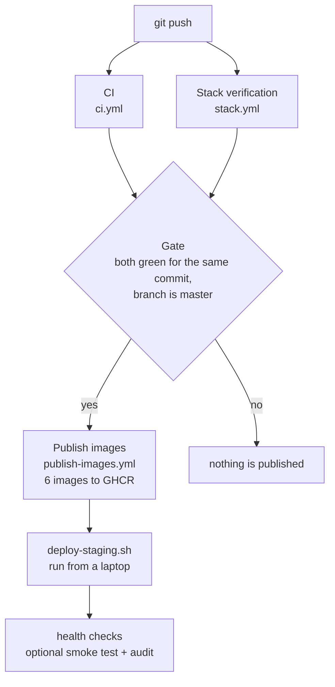

# CI/CD pipeline

How a commit travels from `git push` to running on the AWS staging hosts, and what protects each step.



CI, stack verification and publishing run automatically on GitHub. The last step is a script run on purpose, because the staging hosts cost money and are normally stopped.

## Workflows at a glance

| Workflow | File | Runs on | Typical time | Answers |
|---|---|---|---|---|
| CI | [`workflows/ci.yml`](workflows/ci.yml) | every push, every pull request | about 3-5 min | Is the code correct and safe in isolation? |
| Stack verification | [`workflows/stack.yml`](workflows/stack.yml) | every push, every pull request, manual | about 6 min | Does the whole system work together, and do the invariants hold? |
| Publish images | [`workflows/publish-images.yml`](workflows/publish-images.yml) | when Stack verification finishes on `master`, manual | under 1 min | Which exact build passed every check? |
| Deploy to staging | [`../deploy/cloud/scripts/deploy-staging.sh`](../deploy/cloud/scripts/deploy-staging.sh) | run by hand | a few minutes | Is the tested build running in staging? |

Times are what the recent runs took, not guarantees.

## 1. CI

Independent jobs that run in parallel. The six Go modules are `gateway-simulator`, `inventory-service`, `orchestrator-service`, `order-service`, `payment-service` and `tools`.

| Job | What it checks |
|---|---|
| Unit tests | `go test -race` in every module. Reports pass, fail and skip counts in the job summary (tests that need a database skip here) and uploads a coverage profile. |
| Integration tests | The database-gated tests, run against a throwaway Postgres 16. Each service schema is migrated first, then every `RUN_*_INTEGRATION` test runs with the race detector. |
| Vet and build | `go vet` and `go build ./...` per module. Catches broken imports, moved paths and packages that no test covers. |
| `govulncheck` | Known vulnerabilities in dependencies and in the code paths the services actually call. |
| `gitleaks` | Scans the whole git history for secrets. Two known false positives (test idempotency-key prefixes) are listed in [`../.gitleaksignore`](../.gitleaksignore). |
| Script checks | Python syntax for every `.py` file and the baseline helper's unit tests. |
| Config validation | `docker compose config` on every compose file and `terraform validate` with no backend and no credentials. |

## 2. Stack verification

Starts the real system in Docker on a fresh runner and exercises it. It runs three times in parallel, one per gateway mode (`success`, `decline`, `timeout`), so the outcome-specific correctness phases are exercised too.

Each run:

1. Builds the six images and starts Postgres, RabbitMQ, the four migrations, the inventory seed and the four services with `docker compose up --wait`.
2. Probes the health endpoints of every service from outside the containers.
3. Runs the 22-phase correctness suite (idempotency, concurrency, rollback, error mapping, a successful checkout, a declined payment, an ambiguous timeout).
4. In the `success` leg only, runs the small load smoke test (case c1).
5. Runs the final database audit (phase 22): no negative or oversold stock, no duplicate business keys, no contradictory terminal states.
6. Uploads the results (and container logs on failure) and always tears the stack down.

RabbitMQ's health check waits for the client (AMQP) port. A plain `ping` turned healthy earlier, and services that connect at startup then failed intermittently.

## 3. Publish images

Two jobs.

- **Gate.** Requires the Stack verification run to have succeeded, and CI for the same commit to have succeeded. If either failed, nothing is published.
- **Publish.** Builds six images in parallel for linux/amd64 and pushes them to GitHub Container Registry using the built-in `GITHUB_TOKEN`.

| Image | Built from |
|---|---|
| `order-service`, `inventory-service`, `payment-service`, `orchestrator-service`, `gateway-simulator` | the directory of the same name |
| `loadgen` | `tools/` (load generator and correctness runner) |

All images live in one repository, `ghcr.io/chrisfonseca8/distri`, tagged `<image>-<7-character commit SHA>` (fixed, identifies the exact build) and `<image>-latest` (moves with `master`). The package is public, so hosts can pull without logging in. The tag scheme is the one `compose.cloud.yaml` expects, so the deploy files work with `DISTRI_REPO=ghcr.io/chrisfonseca8/distri` unchanged.

## 4. Deploy to staging

There is no deploy workflow. A GitHub workflow would need an AWS identity (an OIDC provider or stored keys), and this project does not set one up. Deployment is one script, run from a laptop with existing SSH access.

```sh
deploy/cloud/scripts/deploy-staging.sh <tag> --check     # find the hosts, test SSH, check files; change nothing
deploy/cloud/scripts/deploy-staging.sh <tag> --dry-run   # print what would run (needs the five *_HOST variables)
deploy/cloud/scripts/deploy-staging.sh <tag>             # deploy, asking first
deploy/cloud/scripts/deploy-staging.sh <tag> --smoke     # also run c1 and the phase 22 audit (writes to the database)
```

`<tag>` is the 7-character commit SHA of a published run.

1. Finds the five hosts by their EC2 `Name` tag using the local `aws` CLI (read-only), or uses the `*_HOST` variables.
2. Tests SSH to every host and confirms the env and compose files it will rewrite exist.
3. Deploys in dependency order, callee first: gateway simulator, inventory (migrate and seed), payment, order, orchestrator. On each host it rewrites only `DISTRI_REPO` and `IMAGE_TAG` in the host's env file, then runs `pull`, the migration and `up --wait`.
4. Runs health checks from the load-generator host over the private network; any failure fails the script.
5. With `--smoke`, runs load case c1 and the phase 22 audit.
6. Prints the previous tag, so a rollback is the same command with that tag.

Details and prerequisites: [`../deploy/cloud/README.md`](../deploy/cloud/README.md) (section 10).

## What each stage protects against

| Risk | Caught by |
|---|---|
| Broken logic or data race | Unit tests with `-race` |
| Bad queries, missing constraints, oversell | Integration tests on real Postgres |
| Services that cannot start or talk to each other | Stack verification |
| Wrong payment, order or stock state | Correctness suite and the phase 22 audit |
| Vulnerable dependency | `govulncheck` |
| Committed secret | `gitleaks` |
| Untested build reaching staging | The publish gate |
| Half-finished deploy | `up --wait`, failing health checks, and a script that stops on the first error |

## Deliberately not automated

- **Deployment.** Manual, so the paid hosts never start by accident and no AWS credentials live in GitHub.
- **Load sweeps, soak runs and fault injection.** Shared runners are noisy, so numbers from them would mislead. CI checks correctness, not performance claims.
- **Real Razorpay calls.** Every pipeline stage uses the local test gateway or the gateway simulator.

## Known limitations

- No lint or format gate. The code has roughly one hundred `golangci-lint` findings (mostly unchecked `Close()` and `Encode()` errors); the check was removed until they are fixed.
- No image vulnerability scan and no enforced coverage threshold (coverage is uploaded only).
- Correctness phases 8 and 16 (command recovery) need to stop and restart services, so they are skipped in the containerised CI run. The job summary lists skipped phases.
- Deploy trusts each host's SSH key on first connection, and needs your public IP to be allowed on port 22 in the staging security groups. A laptop with several internet uplinks may need all of them listed.
- Rollback is a documented command that has not been exercised.
- Stack verification passes on three gateway modes but each is a single run; the startup race fix has only a handful of passing runs behind it.
