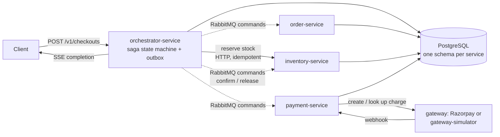

# distri

A distributed checkout and payment backend in Go: an orchestrated saga across four services, a transactional outbox, RabbitMQ commands, PostgreSQL as the source of truth, and a test campaign that measures correctness under faults and throughput under load.

## Why this project exists

To learn, with measurements, how concurrency, architecture and infrastructure change the correctness and performance of a payment flow. The system has no UI; it is driven by APIs, scripts and a Go load generator. The correctness rules it is built around:

- Stock never goes negative, and an order is never reported paid unless its payment succeeded.
- A gateway timeout is ambiguous, not a failure. A possibly-successful payment call is never blindly retried.
- No database transaction is held open across a call to another service or the gateway.
- Every cross-service step is idempotent on the order id and has a compensation.
- Messages are published only through an outbox and acknowledged only after their effect is committed.

## Architecture



| Service | Owns |
|---|---|
| [`orchestrator-service`](orchestrator-service) | Checkout idempotency, the saga state machine and its steps, the outbox relay, status streaming (SSE) |
| [`order-service`](order-service) | Order data and order state transitions |
| [`inventory-service`](inventory-service) | Products, stock, reservations (reserve, confirm, release) |
| [`payment-service`](payment-service) | Payment attempts, reconciliation, webhooks, refunds |
| [`gateway-simulator`](gateway-simulator) | Controllable fake payment gateway (success, decline, timeout, delays) |
| [`tools`](tools) | Load generator, correctness suite (22 phases), chaos harness, baseline runner |

Each service owns its schema; services communicate only through APIs and messages. Details: [`docs/architecture.md`](docs/architecture.md) and [`docs/diagrams/`](docs/diagrams).

## Key results

Measured on AWS (one host per service, single replicas, Neon PostgreSQL) on 1 November 2026. **The payment gateway is simulated**, and it is configured with a 5 s pay delay, so about 5 s of every checkout (about 7 s end to end when idle) is the simulator, not the application. Full tables, caveats and raw data: [`tests/REPORT.md`](tests/REPORT.md). Every test has its own file under [`tests/`](tests/README.md).

| Area | Result | Read with |
|---|---|---|
| Fault tolerance | 7 of 7 fault scenarios passed (service `kill -9`, broker restart, 20 s DB connection drop, 200 ms network delay) with 56-57 sagas in flight: 0 duplicate payments or reservations, 0 unfinished sagas | Accepted checkouts only (57 of 200 were refused while the orchestrator or inventory-service was down); one run per scenario |
| Oversell | 500 concurrent buyers for 10 units: exactly 10 accepted, 490 refused with 409, 0 deadlocks | One run |
| Data integrity | 12,736 of 12,736 sagas completed with orders paid, payments succeeded and reservations confirmed; 0 invariant violations in the final audit | Audit covers the last run's data |
| Sustained throughput | **42.45 accepted/s and 42.45 completed/s over 5 minutes at 700 clients** | Simulated gateway; 5-minute soak, single run |
| Peak throughput | **50.8 completed/s at 1000 clients** (peak, single run, tested up to 1000 clients). At 500 clients two runs gave 37.6/s and 42.9/s | 1000 is where the test stopped, not a ceiling; single points vary by about 20% |
| Open-loop capacity | About 30/s sustainable; backlog builds from 40/s; at 60/s offered, 19.0/s completed with 1,230 checkouts pending at the drain | Closed loop (fixed clients, ~43/s) and open loop (fixed arrival rate, ~30/s) measure different things |
| Correctness suite | All 20 active phases pass across success, decline and timeout gateway modes | No single run covers every phase; decline result holds for a 3 s payment window |
| Ruled out | Orchestrator DB pool, outbox poll interval, payment workers and inventory consumers (one change at a time, 3 repetitions each) did not move throughput | The real limit was not identified |
| Go tests | 292 test functions, all pass against a PostgreSQL container (470 passes with subtests, 0 fail, 0 skipped, `-race`); without a database 334 pass and 130 database-gated tests skip | Counted 8 Nov 2026; per-file detail in [`tests/REPORT.md`](tests/unit/README.md) |

## What changed and what it improved

The five most important changes. The full table, including evidence and measurement type, is in [`tests/REPORT.md`](tests/REPORT.md#changes-and-their-impact).

| Change | Problem | Before | After |
|---|---|---|---|
| Stuck-payment grace policy | An unreachable or ambiguous gateway left payments undecided | Failure surfaced only after the full 5-minute window; saga STUCK at about 12.5 min | Unreachable gateway fails in about 16 s; an ambiguous charge is decided at about 10 min; a late capture is refunded, never accepted *(qualitative)* |
| Bounded refund after payment | Paid order whose follow-up step failed stayed STUCK | Waited indefinitely for a person | After 10 min: refund, cancel, release stock *(qualitative)* |
| Outbox dead state | Unroutable message retried forever | Not documented | Dead after 20 permanent failures; a broker outage does not count (83 publish failures in the broker-restart test, 0 rows dead) *(qualitative)* |
| Idempotency-key validation | Unbounded keys, leaked internal errors | A 300-character key was accepted | Keys capped at 255 characters from a safe charset; clean validation errors *(qualitative)* |
| SSE instead of polling for completion | Client polling loaded the orchestrator | Poll mode peaked at 36.9/s (300 clients) and fell to 20.9/s (600) with 197,692 orchestrator requests | SSE: 50.8/s at 1000 clients with 6,090 requests *(measured, partial pair: different client counts, single runs)* |

## Tech stack

Go (stdlib `net/http`, `log/slog`), GORM and PostgreSQL (Neon in the cloud tests), RabbitMQ, Server-Sent Events, Docker Compose, Terraform on AWS EC2, Prometheus, Grafana, Loki and Tempo for observability, GitHub Actions for CI.

## Run locally

Requires Docker. Credentials in `compose.local.yaml` are disposable development values.

```bash
docker compose -f compose.local.yaml up --build --wait   # Postgres, RabbitMQ, migrations, seed data, four services
tools/load-test/run-cases.sh c1                        # smoke load case against the local stack
docker compose -f compose.local.yaml down                # stop (keeps volumes)
```

More: [`docs/docker.md`](docs/docker.md) (local stack and simulator), [`tools/README.md`](tools/README.md) (load generator and correctness suite), [`deploy/cloud/README.md`](deploy/cloud/README.md) (AWS staging).

## Testing approach

- **Unit and integration tests** live next to the code in each service. Database-gated integration tests run against a throwaway `*_test` database (`tools/integration/run-integration.sh`, and the `integration` job in CI).
- **Correctness suite** (22 phases in [`tools/correctness`](tools/correctness)) runs against a live stack: idempotency, concurrency, rollback, recovery, error mapping and a final database-invariant audit.
- **Fault injection** ([`tools/fault-injection`](tools/fault-injection)) kills services, restarts the broker, drops database connections and delays the network under load, then audits.
- **Load testing** ([`tools/load-test`](tools/load-test)) reports accepted and completed rates separately, plus p95 and p99.
- **Penetration testing has not been done** (authentication is out of scope); see [`tests/penetration`](tests/penetration/README.md).
- Every test and its result: [`tests/`](tests/README.md) (one folder per kind of test; summary in [`tests/REPORT.md`](tests/REPORT.md)).

## Known limitations

- The gateway is a simulator; no real Razorpay Test Mode success path or public-HTTPS webhook was exercised in the cloud runs.
- Every service runs as a single replica; the broker and database are single points of failure. This is a learning deployment, not a high-availability one.
- SSE completion notification is in-process and single-replica, so it does not work across orchestrator replicas.
- The soak lasted 5 minutes; slow leaks (memory, connections, database growth) are not ruled out.
- Most sweep points are single runs.
- Known issues, not yet diagnosed: the `DatabasePoolSaturated` and `ServiceDown` alerts fired during load runs. The pool alert may be too sensitive (hypothesis, untested). See the report.
- Authentication is out of scope.

## Roadmap

1. **CI/CD pipeline:** build and publish images, run the integration job on every push, and deploy to staging from the pipeline.
2. **Auto-scaling:** scale services horizontally. This first needs a cross-replica completion notification (for example a database- or broker-backed path instead of the in-process SSE hub), because with two orchestrator replicas completions handled by one replica never reach clients waiting on the other.
