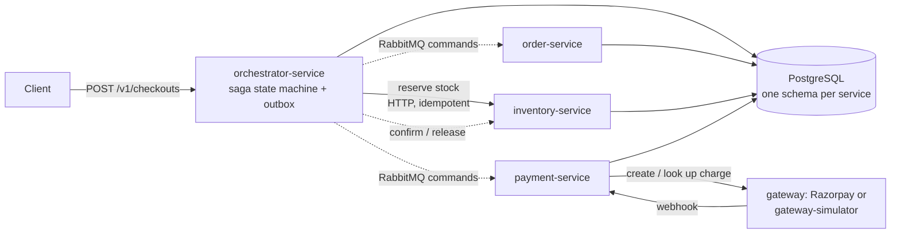

# distri

[](https://github.com/chrisfonseca8/distri/actions/workflows/ci.yml)
[](https://github.com/chrisfonseca8/distri/actions/workflows/stack.yml)
[](https://github.com/chrisfonseca8/distri/actions/workflows/publish-images.yml)

A distributed checkout and payment backend in **Go**. Four services coordinate an order through an orchestrated **saga**, with a transactional **outbox**, RabbitMQ commands, and PostgreSQL as the single source of truth. It was built to learn, with measurements, how concurrency, architecture and infrastructure change the correctness and performance of a payment flow. There is no UI; everything is driven by APIs, scripts and a Go load generator.

## Results at a glance

Measured on AWS in November 2026 against a **simulated payment gateway** (about 5 s of every checkout is its configured pay delay).

| What | Result |
|---|---|
| Sustained load | **100 checkouts/s for 3 minutes: 18,000 of 18,000 completed, 0 errors, saga p95 11.2 s** |
| Highest rate passed | **130 checkouts/s: 23,401 of 23,401 completed, saga p95 11.1 s**; the API accepts a checkout in **67 ms (p95)** |
| Autoscaling workers | At 60/s, saga p95 dropped from **80 s to 10.9 s** after webhook workers and DB pools began scaling on load (two single runs; the client polling interval also changed from 2 s to 5 s) |
| Correctness | **10 of 10 data invariants hold** under load (no oversell, one payment per order, paid orders have a confirmed payment); 500 concurrent buyers for 10 units: **exactly 10 sold** |
| Fault tolerance | **7 of 7 failure scenarios passed** (kill -9 of each service, broker restart, 20 s database drop, 200 ms network delay): 0 duplicate payments, 0 lost checkouts |
| Tests | **470 test passes, 0 failures** with the race detector; correctness suite of 20 phases across success, decline and timeout modes |

Single runs unless stated; details and caveats are in the [test report](tests/REPORT.md).

**Load sweep** (autoscaling build; 60 s warm-up, then a 3-minute measured window; every checkout completed, 0 rejected, 0 server errors; about 5 s of each p95 is the simulated gateway delay):

| Offered load | Completed | Saga p95 |
|---:|---:|---:|
| 50/s | 9,000 of 9,000 | 10.8 s |
| 60/s | 10,801 of 10,801 | 10.9 s |
| 80/s | 14,400 of 14,400 | 11.6 s |
| 100/s | 18,000 of 18,000 | 11.2 s |
| 130/s | 23,401 of 23,401 | 11.1 s |

**More load results** (earlier build, before autoscaling, plus closed-loop tests with a fixed number of clients):

| Test | Result |
|---|---|
| 20 checkouts/s (3 min) | 3,600 of 3,600 completed; saga p95 15.8 s (first run after the stack sat idle, so connections were cold) |
| 30 checkouts/s (3 min) | 5,401 of 5,401 completed; saga p95 11.0 s |
| 40 checkouts/s (3 min) | 7,200 of 7,200 completed; saga p95 11.3 s |
| Baseline, 10 clients | 1.55 checkouts/s, p95 11.3 s end to end, checkout accepted in about 66 ms (p95) |
| Soak, 700 clients, 5 minutes | **42.45 checkouts/s sustained**, 12,736 of 12,736 completed, 0 pending, 0 server errors; throughput held steady (37.9 to 42.0/s per minute) |
| Peak, 1000 clients | **50.8 checkouts/s** (best single run; the test stopped there, it is not a measured ceiling) |

**Codebase** (tracked files): about 49,000 lines of Go across 6 modules (36.6k application, 12.1k test), 301 test functions, 3 CI workflows.

## What is interesting about it

- **Money is never trusted to luck.** Integer minor units only; a gateway timeout is treated as *ambiguous*, never blindly retried; an order is marked paid only after its payment is confirmed.
- **Every cross-service step is idempotent** on the order id and has a compensation (reserve and release, charge and refund). A failed or stuck step is retried, refunded or unwound within a bounded time.
- **Messages go out only through an outbox** written in the same transaction as the state change, and are acknowledged only after their effect is committed.
- **No database transaction is held open across a network call.**
- **Scaling that I measured, not assumed:** workers and connection pools scale on backlog and pool waits, and an AWS Auto Scaling group adds a second orchestrator when CPU passes 50% (it takes 7 to 10 minutes to start serving, so it suits sustained load, not bursts).

## Architecture



| Service | Owns |
|---|---|
| [`orchestrator-service`](orchestrator-service) | Checkout idempotency, the saga state machine, the outbox relay, status streaming |
| [`order-service`](order-service) | Order data and state transitions |
| [`inventory-service`](inventory-service) | Products, stock and reservations |
| [`payment-service`](payment-service) | Payment attempts, reconciliation, webhooks, refunds |
| [`gateway-simulator`](gateway-simulator) | A controllable fake gateway (success, decline, timeout, delays) |
| [`tools`](tools) | Load generator, correctness suite, fault injection, baseline runner |

## Stack

Go (stdlib `net/http`, `log/slog`), GORM and PostgreSQL (Neon), RabbitMQ, Docker Compose, Terraform and AWS (EC2, Auto Scaling, load balancer), Prometheus, Grafana, Loki and Tempo for observability, and GitHub Actions for CI: unit tests with the race detector, integration tests, vulnerability and secret scans, and a full-stack run in Docker for each gateway mode before images are published.

## How it was measured

Accepted and completed rates are reported **separately** (a fast `202` with a growing backlog is not capacity), with open-loop load at a fixed arrival rate, p95 and p99 latency, a data-integrity audit after every run, and one change at a time per experiment.

## Honest limits

- The gateway is a simulator; no real Razorpay payment was exercised in the cloud runs.
- On the free-tier database used for the tests, the end-to-end ceiling is about **130 checkouts/s**. Beyond that the system keeps accepting but completes slower (at 160/s offered it accepted all 28,800 and completed about 90/s), and the database's CPU became the limit.
- Every service except the orchestrator runs as a single replica; this is a learning deployment, not a high-availability one.
- Most points are single runs, and penetration testing has not been done.

## Run it locally

Requires Docker.

```bash
docker compose -f compose.local.yaml up --build --wait   # Postgres, RabbitMQ, migrations, seed data, four services
tools/load-test/run-cases.sh c1                        # smoke load case against the local stack
docker compose -f compose.local.yaml down                # stop
```

More: [load generator and correctness suite](tools/README.md), [AWS staging](deploy/cloud/README.md), [CI/CD pipeline](.github/README.md), every test and result in [`tests/`](tests/README.md), and the autoscaling experiments in [`inprovemts/`](inprovemts).
